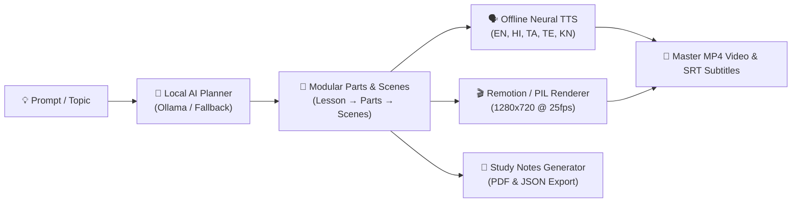

<div align="center">

# 🎓 Blu Visual Teacher
### *Offline-First Vernacular AI Educational Video Studio & Interactive Learning Academy*

[](https://www.python.org/)
[](https://fastapi.tiangolo.com/)
[](https://react.dev/)
[](https://www.typescriptlang.org/)
[](https://www.remotion.dev/)
[](#test-suites--verification)
[](#offline-first-architecture)

<br/>

**Transform any educational concept into an animated video lesson with natural neural speech in 5 languages, synchronized subtitles, structured study notes, and interactive simulations — running completely locally without internet.**

</div>

---

## 🌟 Key Highlights & Innovations



1. **100% Offline-First AI Pipeline**:
   - Runs locally on standard consumer laptops without cloud dependencies, API keys, or recurring internet access.
   - Genuine CPU neural speech synthesis with **Piper ONNX** (Hindi `hi`, Tamil `ta`, Telugu `te`, Kannada `kn`) and **Kokoro ONNX / SAPI5** (English `en`).
2. **Modular Hierarchy & Selective Invalidation**:
   - `Lesson → Parts (~60s) → Scenes → Editable Visuals & Narration`.
   - Independent part export (`POST /api/lessons/{id}/parts/{part_id}/export`) allows rendering single modules without re-rendering the entire video.
   - SHA256-keyed persistent audio disk caching (`outputs/cache/audio/`). Visual changes never trigger TTS re-synthesis.
3. **Approved Production UI**:
   - Faithfully implements the approved design: deep navy (`#0B1120`), chalkboard green (`#234E3B`), warm beveled wood frame (`#7A4B29`), and golden amber accents (`#E59F26`).
   - Integrated in-frame media scrubber, real-time speed selector, captions toggle, and full-screen controls.
4. **2D Pixel-Art Academy RPG ("Blu Academy")**:
   - Gamified school world with 6 subject departments (Maths, CS, Physics, Chemistry, Biology, Social Studies).
   - Meet faculty mentors (Ms. Asha, Prof. Byte, Dr. Newton, Dr. Mira, Ms. Flora, Mr. Atlas), complete interactive lessons, and earn unlockable subject badges.
5. **Interactive Learning Lab ("What-if Lab")**:
   - Zero-latency client-side interactive simulations for **Fractions & Proportions**, **Triangle Geometry & Pythagorean Theorem**, and **Newton's Second Law** ($F = m \cdot a$).
   - Completely decoupled from video rendering for zero export performance overhead.
6. **Multi-Format Export Bundles**:
   - **MP4 Video** (1280x720 H.264 / AAC).
   - **SRT Subtitles** (time-synchronized native script).
   - **PDF Study Notes** (print-ready with Indic Unicode typography).
   - **JSON Notes** (machine-readable structured schema).

---

## 🚀 Quickstart Guide

### Prerequisites
- **Python 3.10+** (tested on Python 3.11 & 3.14)
- **Node.js 18+** & npm
- **FFmpeg & FFprobe** installed locally and available on PATH (or via WinGet)

### 1. Start the FastAPI Backend
```powershell
python -m uvicorn backend.app.main:app --host 127.0.0.1 --port 8000
```
*Interactive Swagger documentation available at: `http://127.0.0.1:8000/docs`*

### 2. Start the Frontend Application
```powershell
cd frontend
npm install
npm run dev
```
*Open `http://localhost:5173` in any modern web browser.*

---

## 🧭 Navigation Architecture

```
Root URL (/)
 ├── 🎨 Chalkboard Intro Animation (tap anywhere to skip)
 ├── 🏛️ Project Landing Page & Product Showcase
 ├── 🎒 Blu Academy RPG School (2D Pixel Hallway & Classrooms)
 └── 🎬 Video Learning Studio (Chalkboard Player, Playlist & Notes)
       ├── ✏️ Modular Scene Editor
       └── 🔬 Interactive What-If Simulation Lab
```

- **Automated Render Bypass**: Calling `/render` or `?render=1` immediately bypasses all intro animations, timers, and audio initialization to provide deterministic Playwright frame capture.

---

## 🧪 Test Suites & Verification

The repository includes comprehensive automated tests covering data contracts, speech engines, timing preservation, layout algorithms, and component rendering:

### Python Backend & Pipeline Tests (96 / 96 Passed)
```powershell
python -m pytest tests/ -v
```
- **`tests/test_api_and_exporter.py`**: Health checks, audio streaming, video streaming, MP4 Remotion rendering, notes download endpoints, and neural speech synthesis.
- **`tests/test_duration_regression.py`**: Rigorous verification that all 7 duration presets (30s, 45s, 60s, 90s, 120s, 180s, 240s) preserve pacing and scene budgets across all subjects.
- **`tests/test_modular_parts_and_editor.py`**: Auto-partitioning, sub-manifest extraction, SHA256 audio hash caching, selective visual vs. narration invalidation, and independent part video exports.
- **`tests/test_timeline_and_adapters.py`**: Timestamp synchronization, independent timing per language, and offline Piper TTS for Tamil & Kannada.
- **`tests/test_knowledge_and_quizzes.py`**: SQLite FTS5 offline index retrieval and quiz question generation.
- **`tests/test_instructional_modes_and_quality.py`**: Pedagogical mode switching (science diagrams vs code walkthroughs).

### Frontend Vitest Suite (104 / 104 Passed across 13 test files)
```powershell
cd frontend
npm run test
```
- **`SceneEditorAndWhatIfLab.test.tsx`**: Scene editor hierarchy, live preview, property editing, and What-if simulation tabs.
- **`ChalkboardLanding.test.tsx`**: Particle canvas rendering, tap-to-skip, and keyboard accessibility.
- **`PlayerFullscreenControls.test.tsx`**: Video wrapper, time scrubber, fullscreen toggle, and caption tracks.
- **`BluAcademy.test.tsx`**: Pixel map collisions, door triggers, NPC dialogues, and camera framing.
- **`DiagramScene.test.tsx` & `CodeWalkthroughScene.test.tsx`**: Visual node layout and syntax highlight lines.

### Frontend Production Build
```powershell
cd frontend
npm run build
```
*Zero TypeScript compiler errors (`tsc && vite build` built in < 1.7s).*

---

## 📁 Repository Structure

```
.
├── backend/                        # FastAPI Backend & Local Services
│   └── app/
│       ├── main.py                 # Core API endpoints & job pipeline
│       ├── schemas/                # Pydantic v2 schemas (LessonPlan, Parts, Manifest)
│       └── services/
│           ├── exporter/           # Video exporter & Remotion runner
│           ├── planner/            # Ollama & fallback deterministic planners
│           ├── tts/                # Piper ONNX & Windows SAPI5 neural adapters
│           ├── notes_generator.py  # Structured study notes generator
│           └── pdf_generator.py    # Unicode Indic PDF renderer
├── frontend/                       # React 18 + TypeScript + Vite + Remotion
│   ├── src/
│   │   ├── components/
│   │   │   ├── ChalkboardLanding/  # Multilingual intro canvas transition
│   │   │   ├── ProjectLandingPage/ # Marketing showcase & feature landing
│   │   │   ├── SceneEditor/        # Modular 3-column scene authoring studio
│   │   │   ├── StudioRedesignLayout.tsx # Approved dark-navy studio view
│   │   │   ├── WhatIfLab/          # Client-side interactive simulations
│   │   │   └── scenes/             # 1280x720 deterministic scene renderers
│   │   ├── game/                   # 2D pixel-art RPG Blu Academy engine
│   │   ├── remotion/               # Remotion compositions & video bundle
│   │   └── styles/                 # Theme tokens & studio CSS
│   └── scripts/                    # Remotion export & UI verification scripts
├── tests/                          # 96 backend Pytest integration tests
└── README.md                       # Comprehensive documentation
```

---

## 📜 Supported Languages & Offline Voice Engines

| Language | Code | Local TTS Engine | Voice Persona |
| :--- | :---: | :--- | :--- |
| **English** | `en` | Kokoro Neural / Windows SAPI5 | Heart, Bella, Adam, Emma, David, Zira |
| **हिन्दी (Hindi)** | `hi` | Piper Neural (ONNX) | Pratham (`hi_IN-pratham-medium`) |
| **தமிழ் (Tamil)** | `ta` | Piper Neural (ONNX) | Rasa (`ta_IN-rasa_female-medium`) |
| **తెలుగు (Telugu)** | `te` | Piper Neural (ONNX) | Padmavathi (`te_IN-padmavathi-medium`) |
| **ಕನ್ನಡ (Kannada)** | `kn` | Piper Neural (ONNX) | SYSPIN (`kn_IN-syspin_male-medium`) |

---

<div align="center">
  <b>Built for reliable offline education across all communities.</b><br/>
  <i>Better learning for every child — even without reliable internet.</i>
</div>
